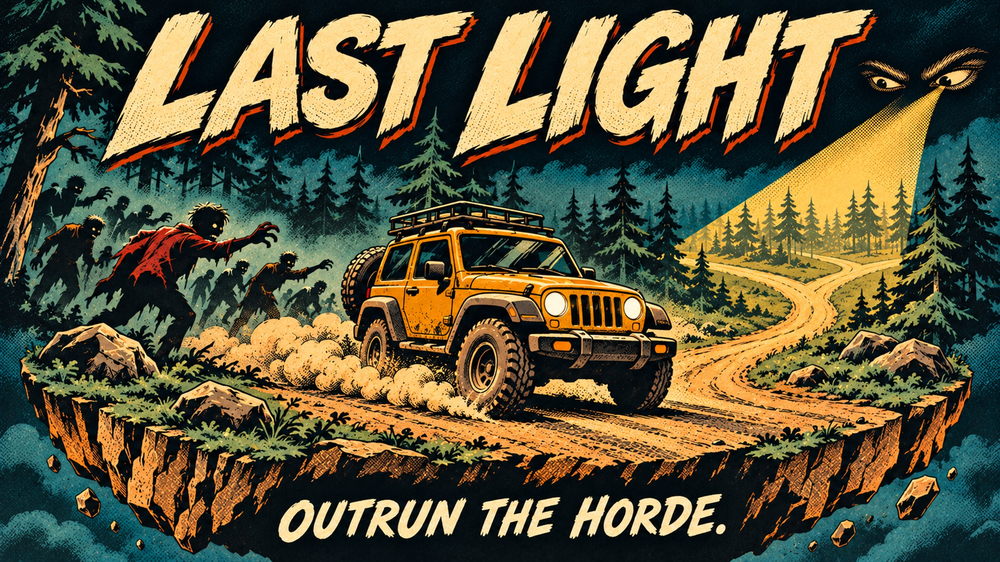

# Last Light

**Outrun a zombie horde in mixed reality and scout the road with your eyes.**

Last Light is a mixed-reality survival driving game for PICO headsets. A miniature forest floats in your room, at night,
with a winding dirt road through it. Down on that road, a little ochre Scout Jeep is running for its life, and a pale
horde of zombies is right behind it. You steer it with your hands. You light the way with your eyes. How far can you
get before the dark catches up?

---

## How it plays

### Your hands drive

A glowing **beacon** floats over the road ahead of the jeep. **Pinch it and drag** it across the road, and the jeep
follows. Either hand works. To pick it up without reaching for it, look at the beacon for a moment, then pinch
anywhere: it flies into your hand.

Your free hand has a job too. When a boulder comes tumbling down from the hillside, **sweep an open hand through it**
to knock it off the road.

### Your eyes scout

It's dark out there. Wherever you look, a warm **scout light** follows your gaze and shows you the road. Read the
bends, spot the rocks and logs, and check which way a split goes before the jeep gets there. You can steer one way
while looking another, and you'll need to.

Your eyes are also how you grab things:

- **Powerups** sit beside the road. Stare at one for a second and it's yours. The deeper you get, the less time it
  takes, down to half a second.
- **Acid spitters** stand by the road and lob acid that slows you down. Stare at one and you'll throw a rock at it.
  Every spitter knocked down is worth **20 coins**.
- **Coins** lie in trails along the road. Just drive through them.

### The road never repeats

Every run builds a fresh road, so you can't learn it. You have to read it:

- **Splits.** The road forks, and one way may end at a wall. Further in, it splits three ways with barricades across
  some branches. When every branch is blocked, one barricade has a gap: aim for it.
- **Cliff roads.** Narrow ledges over a drop. Scrape the edge and you'll throw sparks and lose speed; go over and the
  run is done. Later, twin ledges run side by side, and one of them ends in thin air.
- **The horde.** Every crash and every acid hit slows you down, and the horde closes in. "HORDE CLOSE!" means
  exactly that.

### Weather rolls in

About 500 metres in, the sky starts turning on you:

- **Fog** smothers your scout light. A flashlight cuts straight through it.
- **Thunderstorms** soak the road into puddles and blow broken branches across it.
- **Snow** arrives after 1,600 metres. The road ices over, the jeep slides and skids, and you leave tyre tracks behind.

A dial on the dashboard shows what's coming and how long it lasts.

---

## Powerups

| Powerup | What it does |
|---|---|
| **Speed Boost** | Five seconds of extra speed to open up a lead on the horde. |
| **Shovel** | A plough on the front bumper that smashes through rocks, logs, barricades and dead-end walls. It takes five hits; the dots above the blade show how many are left. |
| **Roof Turret** | Ten seconds of a turret that shoots spitters for you, at 20 coins each. |
| **Shield** | Ten seconds of protection: smash through obstacles without slowing, shrug off acid, and knock the horde back if it catches you. |
| **Flashlight** | Five seconds of light over the whole forest, cutting through darkness and fog alike. |
| **Repairs** | Puts one bar of health back. |

You start each run with three bars of health. Drop to the last bar and a **wrench** appears over the jeep: look at it,
then look at three dots in turn to patch the jeep up. Don't leave a dot waiting too long, or the repair fails and you
start again.

### Storage compartment

The dashboard has a **storage compartment** for powerups you buy between runs. During a run, stare at a slot for half
a second to use what's in it: a radial fill shows the countdown. You start with one slot. More slots cost coins, and the
fourth needs a second vehicle first.

---

## The garage

Coins you collect carry over between runs. Spend them in the **floating garage**, where your vehicle turns on a steel
turntable.

### Vehicles

Each new vehicle needs coins **and** a long enough best run to prove you can handle it.

| Vehicle | Unlock | Perk |
|---|---|---|
| **Scout Jeep** | Free | Old faithful. |
| **Hauler Pickup** | 400 coins, 800 m best run | A fourth storage slot. |
| **Rhino APC** | 1,000 coins, 1,500 m best run | Starts every run with a shovel fitted, plus the fourth slot. |
| **Angel Transponder** | 2,500 coins, 3,000 m best run | One free respawn every run, plus the fourth slot. |

Every vehicle comes in four paint jobs.

### Traits

Upgrade your driving with four **traits**, each with two levels:

| Trait | Level 1 | Level 2 |
|---|---|---|
| **Visibility** | Scout light 15% wider | 30% wider |
| **Controls** | Steadier on ice | Much steadier on ice |
| **Evasion** | 15% chance to shrug off a crash | 40% chance |
| **Recovery** | Back up to speed 15% faster after a crash or acid hit | 35% faster |

The Scout Jeep carries your traits for free. Other vehicles pay a one-time transfer fee to take them on.

---

## When it all goes wrong

Crash out and the **Run Over** panel offers three choices: **Retry** for a fresh road, **Respawn** to carry on where you
fell, or **Main Menu**. A respawn puts the jeep back on the road at full health with a full lead on the horde. The first
one costs 100 coins, and each one after that in the same run costs more than the last.

### Need a break?

Turn either palm towards your face during a run and a **MENU** button appears over your wrist, like checking a watch.
Look at it for a second to pause. The run freezes, and you can **Resume**, **Restart** or go back to the **Main Menu**.
If the headset loses sight of both your hands, the game pauses by itself until they're back.

---

## Controls at a glance

| To... | Do this |
|---|---|
| Steer | Pinch the beacon and drag it across the road |
| Grab the beacon from afar | Look at it, then pinch anywhere |
| Knock away a falling boulder | Sweep an open hand through it |
| Light up the road | Look where you want to see |
| Take a powerup | Stare at it |
| Use a stored item | Stare at its slot on the dashboard |
| Throw a rock at a spitter | Stare at the spitter |
| Press a menu button | Look at it, then pinch |
| Pause | Palm towards your face, then look at the wrist MENU button |

---

## What you need

- A **PICO** headset with **hand tracking** and **eye tracking**. Last Light is built for **PICO Swan**.
- Some space around you. The game plays seated or standing: the forest floats in front of you, and your room stays
  visible around it.

---

*Last Light is in active development. See the [changelog](CHANGELOG.md) for what's new in each build.*
